# Event Storming — личный кабинет

| Цвет | Что это | Как формулируем |
|------|---------|-----------------|
| 🟧 оранжевый | **доменное событие** — факт, который уже случился | прошедшее время: «Заказ оформлен» |
| 🟦 синий | **команда** — намерение что-то сделать | повелительное: «Оформить заказ» |
| 🟨 жёлтый | **актор** — кто отдаёт команду | роль, не должность |
| 🟪 розовый | **политика** или **внешняя система** | «когда произошло X → сделать Y» |
| 🟥 красный | **hotspot** — спорное место, где надо договориться | вопрос, а не утверждение |

## Шаг 1. Доска

```mermaid
flowchart LR
    subgraph s1[" "]
        direction TB
        a1["Пользователь"] --> c1["Войти в ЛК"] --> e1["Пользователь вошёл в ЛК<br/><i>[Аутентификация]</i>"]
        c1 -.-> e1x["Вход отклонён<br/><i>[Аутентификация]</i>"]
    end

    subgraph s2[" "]
        direction TB
        a2["Пользователь"] --> c2["Добавить товар из рекомендации в корзину"] --> e2["Товар из рекомендации добавлен в корзину<br/><i>[Заказы]</i>"]
    end

    subgraph s3[" "]
        direction TB
        a3["Пользователь"] --> c3["Оформить заказ"] --> e3["Заказ оформлен<br/><i>[Заказы]</i>"]
    end

    subgraph s4[" "]
        direction TB
        a4["Пользователь"] --> c4["Оплатить заказ"] --> e4["Заказ оплачен<br/><i>[Оплата]</i>"]
        c4 -.-> e4x["Оплата отклонена<br/><i>[Оплата]</i>"]
        e4 --- x4["Платёжный шлюз"]
        e4x --- x4
    end

    subgraph s5[" "]
        direction TB
        a5["Пользователь"] --> c5["Оплатить баллами"] --> e5["Баллы списаны<br/><i>[Лояльность]</i>"]
        h5["Оплата отклонена после списания баллов — вернуть баллы?"]
    end

    subgraph s7[" "]
        direction TB
        a7["Пользователь"] --> c7["Изменить профиль"] --> e7["Профиль изменён<br/><i>[Профиль]</i>"]
    end

    subgraph s8[" "]
        direction TB
        e8["Заказ передан в доставку<br/><i>[Доставка]</i>"] --- x8["Служба доставки"]
    end

    subgraph s9[" "]
        direction TB
        e9["Заказ доставлен<br/><i>[Доставка]</i>"] --- x9["Служба доставки"]
        e9x["Доставка задержана<br/><i>[Доставка]</i>"] --- x9
    end

    subgraph s9b["ветка: доставка задержана"]
        direction TB
        a9["Пользователь"] --> c9["Создать обращение"] --> e9a["Обращение создано<br/><i>[Поддержка]</i>"]
        e9a --> a9b["Оператор поддержки"] --> c9b["Ответить на обращение"] --> e9b["Поддержка ответила<br/><i>[Поддержка]</i>"]
    end

    subgraph s10[" "]
        direction TB
        p10["Когда «Заказ доставлен» → начислить баллы"] --> e10["Баллы начислены<br/><i>[Лояльность]</i>"]
        h10["Начислять после доставки, а не после оплаты?"]
    end

    subgraph s11[" "]
        direction TB
        p11["Когда истёк срок баллов → списать сгоревшие баллы"] --> e11["Баллы сгорели<br/><i>[Лояльность]</i>"]
    end

    s1 --> s2 --> s3 --> s4 --> s5 --> s7 --> s8 --> s9 --> s10 --> s11
    s9 -.-> s9b

    classDef event fill:#ff9f43,stroke:#c46f12,color:#000000;
    classDef command fill:#4a90e2,stroke:#2e6295,color:#ffffff;
    classDef actor fill:#ffe066,stroke:#b39b2d,color:#000000;
    classDef policy fill:#e056a0,stroke:#9c2a68,color:#ffffff;
    classDef external fill:#f8b8d0,stroke:#9c2a68,color:#000000;
    classDef hotspot fill:#ff4d4d,stroke:#a30000,color:#ffffff;
    classDef step fill:transparent,stroke:#cccccc;

    class e1,e1x,e2,e3,e4,e4x,e5,e7,e8,e9,e9x,e9a,e9b,e10,e11 event;
    class c1,c2,c3,c4,c5,c7,c9,c9b command;
    class a1,a2,a3,a4,a5,a7,a9,a9b actor;
    class p10,p11 policy;
    class x4,x8,x9 external;
    class h5,h10 hotspot;
    class s1,s2,s3,s4,s5,s7,s8,s9,s9b,s10,s11 step;
```

**Что видно на доске:**
- Два события происходят без актора: начисление и сгорание баллов.
- Платёжный шлюз и служба доставки вне нашей зоны контроля — здесь будет ACL.
- Ветка задержки доставки меняет актора, появляется оператор поддержки.
- У личного кабинета нет своих доменных событий. Обновление его данных это синхронизация read-модели. ЛК не владеет ни одним процессом, он потребитель событий остальных контекстов.

## Шаг 2. Bounded Context

### 1. Аутентификация

**События:** пользователь вошёл в ЛК, вход отклонён.

**Язык:** аутентификация, авторизация, вход, выход, сессия

**Владеет:** пользовательскими сессиями

### 2. Заказы

**События:** товар из рекомендации добавлен в корзину, заказ оформлен.

**Язык:** заказ, товар, корзина, позиция

**Владеет:** заказами пользователей

### 3. Оплата

**События:** заказ оплачен, оплата отклонена.

**Язык:** платеж, возврат, сумма, платежный провайдер

**Владеет:** платежами и возвратами

### 4. Лояльность

**События:** баллы списаны, баллы начислены, баллы сгорели.

**Язык:** баллы, баланс, срок действия, транзакция

**Владеет:** начислениями и списаниями

### 5. Профиль

**События:** профиль изменён.

**Язык:** профиль, персональные данные, контакты, согласие на рассылку

**Владеет:** персональными данными

### 6. Доставка

**События:** заказ передан в доставку, заказ доставлен, доставка задержана.

**Язык:** отгрузка, адрес, трек-номер, срок доставки

**Владеет:** маршрутами, отгрузками, задержками

### 7. Поддержка

**События:** обращение создано, поддержка ответила.

**Язык:** обращение, ответ, запрос

**Владеет:** запросами и ответами

### Один термин — разные модели

**Пользователь:** в аутентификации это учетная запись (данные входа, сессии, неудачные попытки входа), в профиле клиент (контакты, ФИО, дата рождения), в лояльности участник программы (баланс, уровень программы), а в доставке получатель (адрес).

**Заказ:** в доставке это вес, адрес, трек-номер. В заказах состав и цена. В лояльности сумма для начисления.

## Шаг 3. Context Map

Связи между контекстами и их типы вынесены отдельно: [`views/context-map.md`](views/context-map.md).

## Шаг 4. Сверка с ДЗ №3

В ДЗ №3 получилось [шесть сервисов](05-services-boundaries.md), а на [декомпозиции](views/decomposition.md) личный кабинет был нарисован отдельным ограниченным контекстом. Здесь — семь контекстов. Сравниваю.

| Из ДЗ №3 | Контекст из ДЗ №4 | Итог |
|----------|-------------------|------|
| Сервис лояльности | Лояльность | совпало, на доске проступил процесс: списание, начисление, сгорание |
| Сервис рекомендаций | — | **не проступил** |
| Сервис профилей | Профиль | совпало |
| Управление историей заказов | Заказы | совпало по составу, сместилось по смыслу |
| Сервис аутентификации | Аутентификация | совпало |
| Сервис поддержки | Поддержка | совпало, граница видна по смене актора |
| Личный кабинет (контекст на декомпозиции) | — | это **не доменный контекст**, слой композиции |
| — | Оплата | **новый** |
| — | Доставка | **новый** |

### Расхождение 1. Рекомендации не проступили

«Товар из рекомендации добавлен в корзину» по словарю относится к Заказам. Своих событий у рекомендаций нет, подборка работает как запрос-ответ, а не как процесс во времени.

### Расхождение 2. Личный кабинет — не доменный контекст

На декомпозиции ЛК обведён как «Ограниченный контекст». На доске он сначала появился событием «Данные кабинета обновлены», но проверка языком бизнеса это событие не прошла. ЛК ничего не решает и ничем не владеет как первоисточник, он показывает то, что произошло в других контекстах.

### Расхождение 3. Появились Оплата и Доставка

Платёжный шлюз и служба доставки были только внешними системами. На доске через них проходит основной процесс, и вокруг них собрались свои кластеры со своим языком: платёж и возврат, отгрузка и трек-номер. Граница с внешним миром проходит не по самим контекстам, а по их краю (там стоит ACL).

### Расхождение 4. История заказов стала Заказами

Изначально сервис был описан как «агрегация информации о покупках и статусах заказов». На доске у Заказов оказался собственный процесс: корзина и оформление. А статусы доставки ушли в Доставку. Название «История заказов» описывало экран, а не домен.

### Расхождение 5. Появились вопросы, которых не было

Две метки hotspot на доске: вернуть ли баллы, если оплата отклонена после списания, и начислять ли баллы после доставки, а не после оплаты. Оба вопроса стоят на стыке Лояльности с Оплатой и Доставкой.

### Вывод

Четыре из шести сервисов совпали, декомпозиция от возможностей выдержала проверку. Расхождения показали две вещи. Event Storming не видит контекстов, которые живут запросами (рекомендации), поэтому методы дополняют друг друга, а не заменяют. Личный кабинет это не домен, а слой композиции над доменами, его граница проходит по способу получения данных, а не бизнес процессу.
