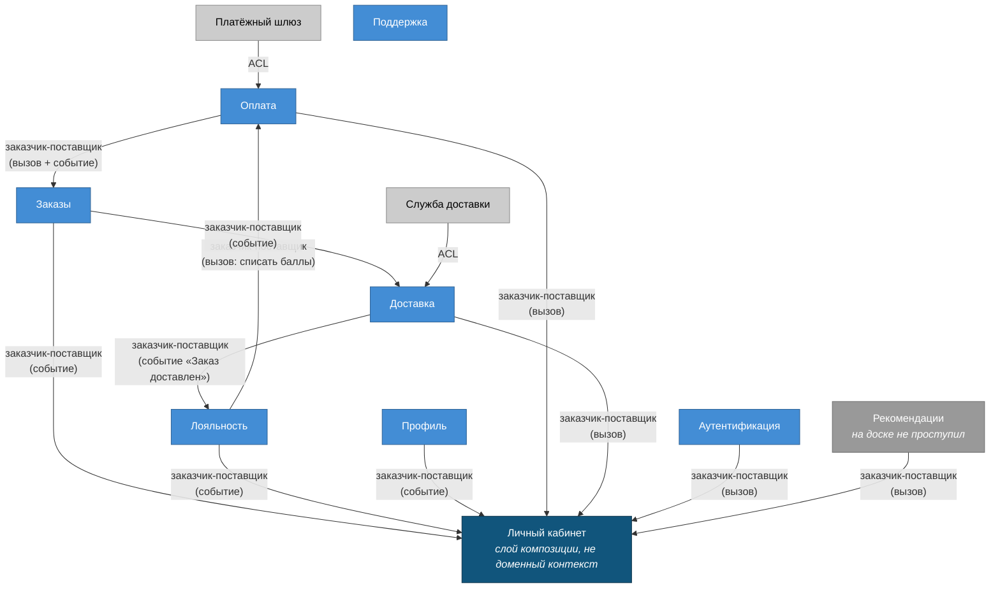

# Context Map

Контексты найдены в [`07-event-storming.md`](../07-event-storming.md), здесь связи между ними, кто от кого зависит и кто под кого подстраивается при изменениях.

## Типы связей

**Партнёрство.** Контексты меняются согласованно, одним релизом. Ни один не может изменить контракт в одностороннем порядке. Самая дорогая связь: она означает, что две команды обязаны договариваться постоянно.

**Заказчик-поставщик.** Один контекст выше по потоку, другой ниже. Поставщик даёт контракт, заказчик под него подстраивается. Отдельно важно, кто контрактом владеет: обычно поставщик, но бывает и наоборот, и это принципиально разные ситуации.

**ACL (anti-corruption layer).** Чужая модель останавливается на границе и переводится в нашу. Ставим там, где не хотим, чтобы внешняя терминология протекла внутрь.

## Карта

## Разбор связей

### Оплата → Заказы: заказчик-поставщик

Заказы отправляют заказ на оплату и ждут резултат. Оплата поставщик, она определяет как выглядит платеж и его резултат.

### Лояльность → Оплата: заказчик-поставщик

При оплате Оплата просит Лояльность списать баллы. Формат запроса отдает Лояльность.

### Заказы → Доставка: заказчик-поставщик

Доставка получает оформленный заказ. Контракт события формируют Заказы.

### Доставка → Лояльность: заказчик-поставщик

Лояльность слушает события Доставки для начисления баллов.

### Платёжный шлюз → Оплата, Служба доставки → Доставка: ACL

Внешние системы вне нашей зоны контроля, свои форматы и контракты. На границе адаптер переводит их в нашу модель.

### Все → Личный кабинет: заказчик-поставщик

ЛК заказчик для всех и ни для кого не является поставщиком. Заказы, Лояльность и Профиль отдают ему данные событиями в read-модель, Оплата, Доставка, Аутентификация и Рекомендации синхронными вызовами. Своих доменных событий у ЛК нет, поэтому на доске он не проступил как контекст.
